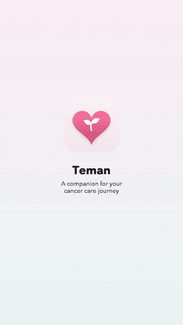
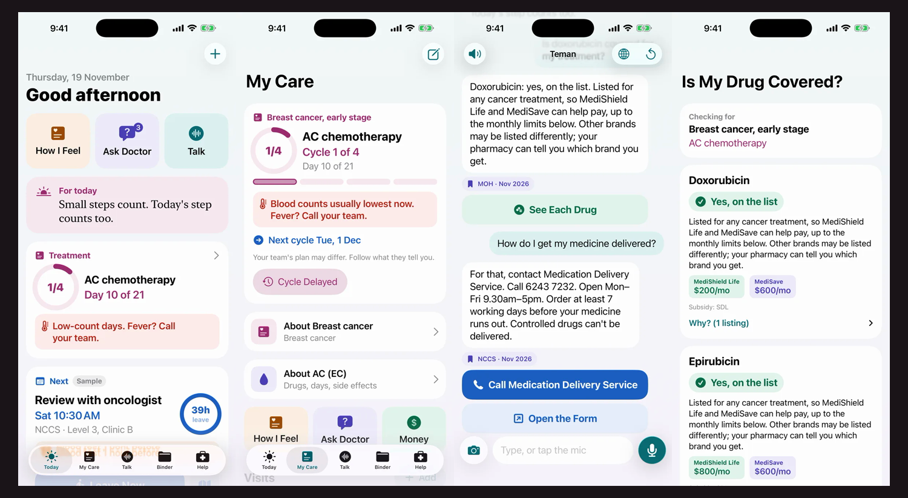

# Teman: a cancer care companion for Singapore

*Teman* means "companion" in Malay. Teman is an iOS app that helps people with cancer in Singapore, and the people who care for them, to:

- understand a diagnosis and the medical words around it
- find the right care: physical, emotional, psychological and financial
- keep track of appointments and get to them
- understand the treatment process and its side effects
- ask their doctors the right questions, and speak up for themselves

**Project site:** https://cweekiat.github.io/teman/

<a href="https://cweekiat.github.io/teman/#demo"><b>▶ Watch the 45-second demo</b></a> · <a href="docs/assets/video/teman-demo.mp4">MP4</a>

<a href="https://cweekiat.github.io/">More projects</a>

> Teman is not a medical product and does not give medical advice.

---

## What Teman will never do

These are product boundaries, not disclaimers added at the end.

| Teman does **not** | Instead, Teman |
|---|---|
| Diagnose cancer or interpret a result as good or bad | Explains what a term *means*, cites the source, and suggests the question to ask the doctor |
| Choose, rank or recommend a treatment | Explains how a treatment the care team has named generally works, with citations, and helps the patient prepare questions about it |
| Determine clinical-trial eligibility | Explains what trials are and gives questions to ask the oncologist |
| Replace the medical team | Sends every clinical question back to the care team, and gives emergency numbers (995) prominence |
| Say anything medical without a source | Cites a named, trusted source for every medical statement and shows when it was last checked. If there is no source, it does not answer |
| Share patient information | Keeps all data on the device, with no accounts, analytics or ads. Data leaves the phone only when the patient exports it |

## Who it is for

The work is built around three things patients and caregivers say:

> "You have to be a huge patient advocate. Push for answers. Push for biopsies. Push for proper testing. Ask questions."

> "I need help navigating difficult conversations and advocating for myself."

> "The volume of doctors, documents, and insurance paperwork can quickly become overwhelming."

## The journey Teman follows

1. **Just diagnosed:** understand the words and know what to ask first.
2. **Building the care team:** know who is who and who to call.
3. **Planning treatment:** prepare questions, understand options the doctor has named, and get a second opinion.
4. **Paying for care:** MediShield Life, the Cancer Drug List, MediSave, MediFund and charity schemes.
5. **During treatment:** appointments, transport, side effects and when to call.
6. **Mind and family:** psychosocial support, caregivers and difficult conversations.
7. **After treatment, or when the goals of care change:** survivorship, or palliative and hospice care.

## Docs

| Doc | What's in it |
|---|---|
| [Disclaimer, Terms and Privacy Policy](docs/legal.md) | The in-app legal text for this community project |
| [Source registry](docs/sources.md) | Every trusted Singapore source Teman draws on, and the review cadence |

## In an emergency

Teman is not an emergency service. Call **995** for an emergency ambulance in Singapore. If you are on cancer treatment and feel unwell, call the number your care team gave you.

## Licence

Documentation: CC BY 4.0. Code samples: MIT. Source content belongs to its publishers. Teman links to and cites it, and does not republish it.
